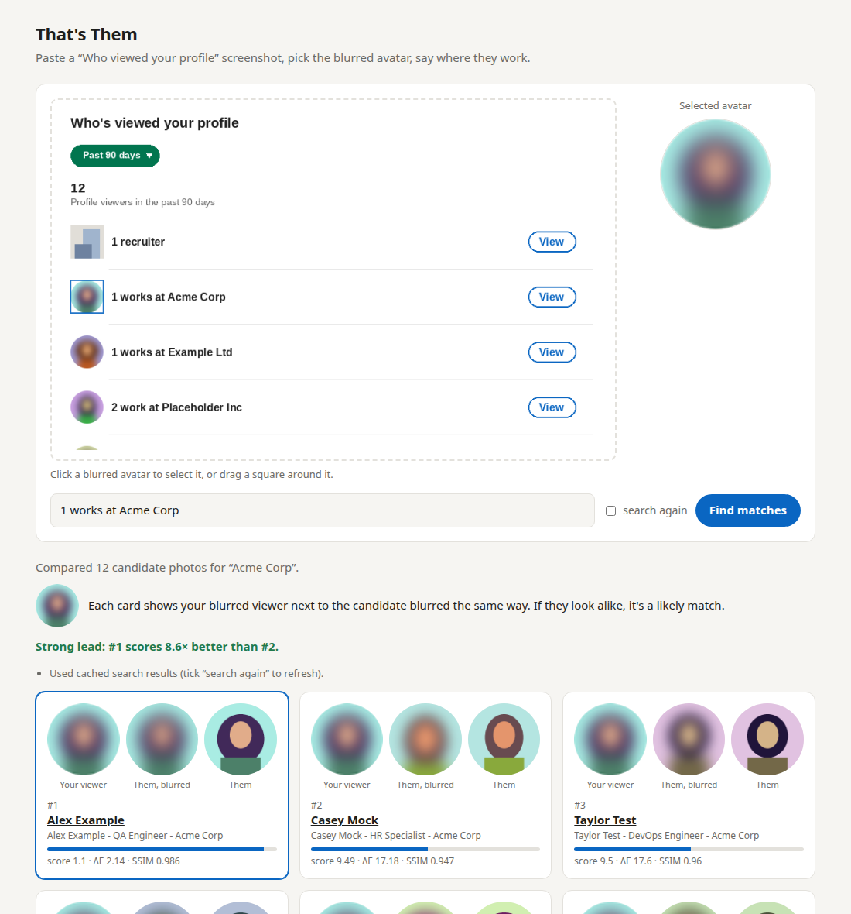

# That's Them

**Proof of concept.** Match a blurred avatar from LinkedIn's "Who viewed your profile" page against
public profile photos of people at the company it names.



*Screenshot uses made-up names and generated faces.*

> [!WARNING]
> **This tool is close to useless in practice.** LinkedIn shuffles the blurred
> avatars every time the page is refreshed. The same row, even one that says
> "1 works at …", shows a different person's photo each time. So the blurred
> photo usually isn't the viewer. A good match only tells you whose photo
> LinkedIn chose to display, not who looked at your profile. This is a proof of
> concept for matching blurred images, not a way to identify viewers.

## How it works

The blur can't be undone, so the tool works the other way round. It finds
candidates at the named company through a web search, blurs each of their
photos the same way, and ranks them by how closely they match the avatar. It
compares colour and structure (Lab ΔE and SSIM) over a range of blur strengths
and crops.

If #1 scores far better than #2, that's a strong lead. If the top results score
about the same, the blur doesn't hold enough detail, or the person isn't among
the candidates.

## Setup

```
uv venv .venv
uv pip install --python .venv/bin/python pillow numpy scikit-image flask ddgs
```

## Use

```
.venv/bin/python app.py
```

1. Open http://127.0.0.1:5000.
2. Paste a screenshot (Ctrl+V).
3. Click the blurred avatar.
4. Type the hint, e.g. `1 works at Acme Corp`. Add `, City` to narrow the
   search.

From the command line:

```
.venv/bin/python fetch_candidates.py "Acme Corp" candidates/acme_corp/
.venv/bin/python match.py targets/avatar.png candidates/acme_corp/ -o report.html
```

## Search

- **Default:** DuckDuckGo. It needs no API key, but it's unofficial and
  rate-limited, and some people won't have a photo.
- **Google:** set `GOOGLE_API_KEY` and `GOOGLE_CSE_ID` to use Google
  Programmable Search instead. It's free for 100 queries a day.

LinkedIn pages are never requested directly; photos come from search engine
results. You can also drop your own candidate photos into
`candidates/<company>/`.

## Caveats

- A match is a lead, not proof.
- Because of the shuffling described above, a strong match on the image
  doesn't mean that person viewed your profile.
- `candidates/` and `targets/` hold other people's photos and are git-ignored.
  Keep them that way.
